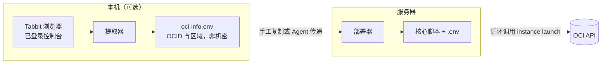
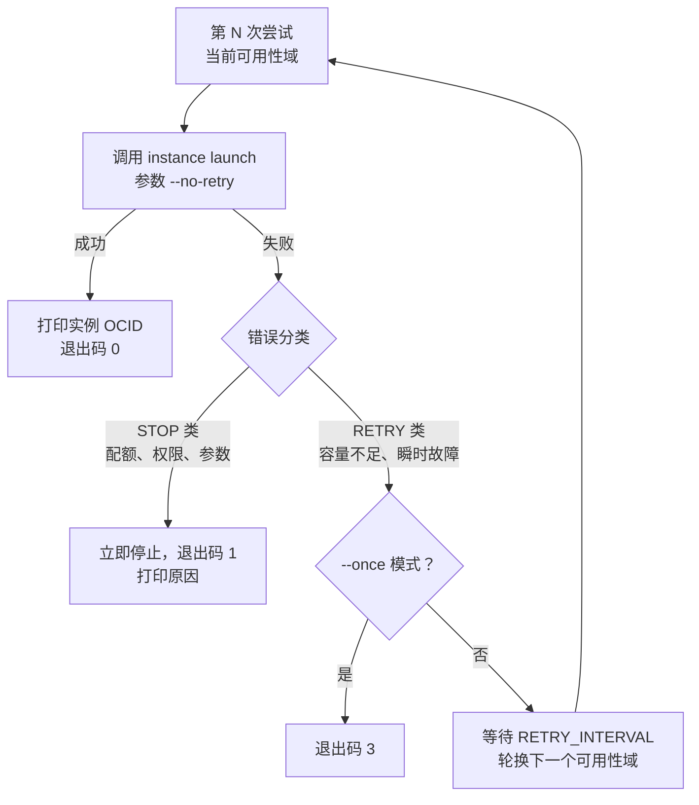

# oci-arm-kit

甲骨文云（OCI）Always Free ARM 实例自动创建工具包。

目标实例规格为 `VM.Standard.A1.Flex`（2 OCPU + 12GB）。热门区域的 ARM 容量长期不足，手动创建失败率高。
本工具包循环调用官方 API 创建实例。某个可用性域没有容量时，工具等待后轮换下一个可用性域。
创建成功后，工具自动退出。工具不会重复创建实例。


## 📖 目录

- [📦 组件](#-组件)
- [🔄 工作流程](#-工作流程)
- [🚀 快速开始](#-快速开始)
- [⚙️ 脚本参考](#-脚本参考)
- [🧠 核心算法](#-核心算法)
- [🩺 离线自检](#-离线自检)
- [❓ 常见问题](#-常见问题)
- [🔒 安全与约定](#-安全与约定)
- [🗂 版本](#-版本)
- [📄 许可](#-许可)

## 📦 组件

| 文件 | 运行位置 | 作用 |
|---|---|---|
| `oci-arm-catcher.sh` | 服务器或任意 Linux | **核心脚本**。循环创建实例，分类错误，轮换可用性域，成功后退出。可独立运行。 |
| `oci-arm-auto.sh` | 服务器（Ubuntu / Debian） | **部署器**。安装 OCI CLI、生成密钥、引导添加公钥、验证认证、查询子网与镜像、生成配置文件、启动抢购。 |
| `oci-info-from-tabbit.sh` | 本机（Windows + Git Bash） | **提取器**。从已登录的 Tabbit 浏览器读取租户 OCID、用户 OCID、区域代码与指纹。 |
| `tests/catcher-selftest.sh` | 任意（需 python3） | **离线自检**。用桩命令验证核心脚本，不触网。 |
| `GUIDE.md` | — | **使用指南**。含每一项信息的获取位置、格式、验证方法与信息对照检查清单。 |

> **约定**　三个组件的名称在全部文档中固定不变：核心脚本、部署器、提取器。

## 🔄 工作流程



> 本机侧解决信息来源问题。服务器侧解决自动创建问题。

## 🚀 快速开始

先选择方式：

| 你的情况 | 方式 | 入口 |
|---|---|---|
| 用 AI Agent（Claude Code、ZCode 等）代劳 | 方式 C | [Agent 提示词模板](#方式-cagent-提示词调用) |
| 电脑装有 Tabbit，且已登录控制台 | 方式 A | 全自动流水线 |
| 不用浏览器，愿按提示输入少量信息 | 方式 B | 部署器或核心脚本的交互模式 |

### 方式 A：全自动（本机有 Tabbit）

```bash
# 1. 本机读取接入信息。产出 oci-info.env。
bash oci-info-from-tabbit.sh -o oci-info.env

# 2. 上传三个文件到服务器。<KEY> 为 SSH 私钥路径。<SERVER> 为服务器地址。
scp -i <KEY> oci-arm-auto.sh oci-arm-catcher.sh oci-info.env ubuntu@<SERVER>:~/

# 3. 部署。部署器与核心脚本必须位于同一目录。
ssh -t -i <KEY> ubuntu@<SERVER> "source ~/oci-info.env && bash ~/oci-arm-auto.sh"
```

部署器打印公钥后，在控制台粘贴该公钥，然后按回车。其余步骤自动完成。

### 方式 B：交互式（无浏览器依赖）

```bash
scp -i <KEY> oci-arm-auto.sh oci-arm-catcher.sh ubuntu@<SERVER>:~/
ssh -t -i <KEY> ubuntu@<SERVER> "bash ~/oci-arm-auto.sh"
```

部署器依次提示三项操作：粘贴公钥确认、输入三个标识、完成。每一项都标注在控制台中的位置。

单独运行核心脚本时，核心脚本逐项询问缺失的配置：

```bash
cd ~/oci-arm-catcher && ./oci-arm-catcher.sh
```

### 方式 C：Agent 提示词调用

将下面模板补全后发送给 AI Agent。完整模板见 [GUIDE.md](GUIDE.md) 第 5 章。

```text
帮我部署甲骨文 ARM 抢购工具包，信息如下：
- 服务器：ubuntu@<SERVER>，SSH 私钥：<本机私钥路径>
- 工具包文件：本机 oci-arm-auto.sh 与 oci-arm-catcher.sh（同目录）
- OCI_USER_OCID=<用户OCID>   OCI_TENANCY_OCID=<租户OCID>   OCI_REGION=<区域代码>
- API 密钥：请让部署器在服务器生成新密钥，并把公钥给我，我去控制台粘贴
要求：先 scp 上传两个脚本到服务器 → 用 --no-start 部署并回报结果 →
我粘贴公钥后完成后台启动 → 告诉我查看日志的命令。
```

## ⚙️ 脚本参考

### 核心脚本（oci-arm-catcher.sh）

```text
用法: ./oci-arm-catcher.sh [选项]
  --env-file FILE   指定配置文件。默认依次查找 ./arm.env、脚本同目录/arm.env、
                    ./.env、脚本同目录/.env。
  --name NAME       实例显示名。默认 arm-free-1。
  --ocpus N         实例 OCPU 数。默认 2。
  --memory N        实例内存 GB。默认 12。
  --interval SEC    重试间隔秒数。默认 300。低于 300 可能触发限流。
  --once            只尝试一次。成功 0 / 容量不足 3 / 其他错误 1。适合 Agent 巡检。
  -h, --help        显示帮助。   -V, --version  显示版本号。
```

| 配置键（.env 与环境变量同名） | 必填 | 说明 |
|---|---|---|
| `COMPARTMENT_ID` | 是 | 租户 OCID（根区间）或子区间 OCID |
| `SSH_KEY_FILE` | 是 | 实例登录公钥路径（`.pub` 文件） |
| `SUBNET_ID` | 是 | 公有子网 OCID |
| `IMAGE_ID` | 是 | aarch64 镜像 OCID |
| `AVAILABILITY_DOMAIN` 或 `AVAILABILITY_DOMAINS` | 是 | 单个，或逗号分隔多个。多个时轮换 |
| `DISPLAY_NAME` / `OCPUS` / `MEMORY_GB` / `RETRY_INTERVAL` | 否 | 默认 `arm-free-1` / `2` / `12` / `300` |

> **退出码**　`0` 成功。`1` 配置错误或不可重试错误。`2` 参数错误。`3` `--once` 模式容量不足。

### 部署器（oci-arm-auto.sh）

```text
用法: bash oci-arm-auto.sh [选项]
  --key FILE            复用已有 API 私钥。指纹自动计算。
  --name NAME           实例显示名。
  --ocpus N             实例 OCPU 数。      --memory N   实例内存 GB。
  --interval SEC        重试间隔秒数。
  --subnet OCID         直接指定子网，跳过查询。   --image OCID  直接指定镜像。
  --os NAME             镜像系统。默认 Canonical Ubuntu。可传 "Oracle Linux"。
  --noninteractive      非交互模式。全部输入来自环境变量。
  --no-start            只部署，不启动抢购。
  -h, --help            显示帮助。   -V, --version  显示版本号。
```

环境变量：`OCI_USER_OCID`、`OCI_TENANCY_OCID`、`OCI_REGION`、`OCI_PUBLIC_KEY_ADDED=yes`、
`OCI_SUBNET_ID`、`OCI_IMAGE_ID`、`OCI_OS`、`OCI_ARM_CATCHER_SRC`。

> **注意**　部署器把核心脚本安装到 `~/oci-arm-catcher/`，并在同目录生成 `.env`。
> 部署器与核心脚本必须放在同一目录。

### 提取器（oci-info-from-tabbit.sh）

```text
用法: bash oci-info-from-tabbit.sh [-o FILE] [-q]
  -o, --write-env FILE   结果写入 FILE。权限 600。文件含 export，可直接 source。
  -q, --quiet            只输出结果。
  -h, --help / -V, --version
```

## 🧠 核心算法



| 分类 | 匹配的错误 | 行为 |
|---|---|---|
| STOP | `LimitExceeded`、`NotAuthorizedOrNotFound`、`NotAuthenticated`、`InvalidParameter`、`CannotParseRequest`、`NotAllowed`、未知错误 | 立即停止。重试无意义。打印原因，提示检查配额或配置。 |
| RETRY | `Out of host capacity`、`InternalError`、`TooManyRequests`、`ServiceUnavailable`、`timed out`、`RequestException` 等 | 等待 `RETRY_INTERVAL` 秒后重试。多个可用性域时依次轮换。 |

三个设计要点：

1. 启动参数 `--no-retry` 关闭 OCI CLI 的内层重试。每次尝试耗时可控，重试间隔准确。
2. 创建成功后核心脚本自动退出。重跑前先确认是否已创建实例。
3. 2026-06 起，Always Free 的 A1 额度为 2 OCPU + 12GB。超配请求返回 `LimitExceeded`，命中 STOP 分类。

## 🩺 离线自检

自检不触网，不消耗配额。桩命令模拟真实错误流，验证核心脚本的行为：

```bash
bash tests/catcher-selftest.sh

# == 用例 1：容量不足 → 轮换可用性域 → 成功    ✓✓✓
# == 用例 2：LimitExceeded（配额类）→ 立即停止  ✓
# == 用例 3：--once 容量不足 → 退出码 3         ✓
# == 用例 4：缺少必填配置 → 退出码 1            ✓
# 全部通过：6 项检查
```

## ❓ 常见问题

**1. 为什么不让工具从浏览器读取 API 私钥？**

控制台只在生成密钥时提供私钥下载，之后不再显示。私钥丢失后无法找回。
本工具包采用另一种方案：私钥在服务器本地生成，永不经过浏览器。
操作者只需在控制台粘贴公钥。公钥可以重复粘贴。

**2. 认证失败（`oci iam region list` 报错）怎么办？**

按顺序检查三项：公钥是否整段粘贴、是否点击了"添加"、脚本显示的指纹与控制台列表是否一致。
部署器支持失败后按回车重试。

**3. 提取器报"未找到控制台标签页"怎么办？**

先在 Tabbit 中打开并登录 `cloud.oracle.com`，再运行提取器。
Oracle 改版后菜单文案可能变化。按报错信息调整提取器中的中文菜单关键词。

**4. 日志出现 `LimitExceeded` 后工具停止。这是错误吗？**

不是。这是预期行为。配额已满，重试不会成功。核心脚本停止并打印原因。

**5. 创建成功后做什么？**

在控制台进入 Compute → Instances 确认实例。然后登录实例：

```bash
ssh -i ~/.ssh/id_ed25519 ubuntu@<实例公网IP>   # Ubuntu 镜像。Oracle Linux 用 opc。
```

确认抢购进程已退出：`pkill -f oci-arm-catcher`。

**6. 如何修改配置并重跑？**

修改 `~/oci-arm-catcher/.env`，或带参数重跑核心脚本。重新部署整机时再次运行部署器。
部署器可重复执行。

## 🔒 安全与约定

- API 私钥只保存在服务器 `~/.oci/oci_api_key.pem`。权限 600。脚本不向第三方发送数据。
- 源码不含真实凭据。只有 `ocid1.user.*` 之类的格式校验模式。
- `.gitignore` 排除运行生成的 `.env` 与密钥文件。
- 脚本只使用相对路径与 `$HOME`、`$LOCALAPPDATA` 等标准环境变量。
- 文档占位符：`<KEY>`、`<SERVER>`、`<实例公网IP>`。
- `.env` 与 `oci-info.env` 中的 OCID 属非机密标识。仍建议按凭据件管理：权限 600，不入库。

## 🗂 版本

| 版本 | 日期 | 说明 |
|---|---|---|
| v3.0.0 | 2026-10-13 | 核心算法独立成核心脚本。新增离线自检。部署器改为同目录安装，取消 git 依赖。文档重构。 |
| v2.0.0 | 2026-10-13 | 统一帮助、选项与退出码。新增非交互模式、`--no-start`、`--subnet`、`--image`、`--os`。 |
| v1.0.0 | 2026-10-13 | 初版。 |

## 📄 许可

[MIT](LICENSE)