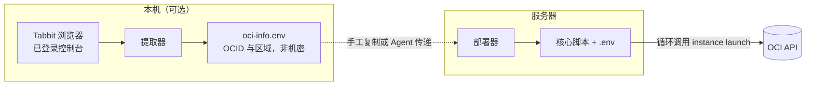
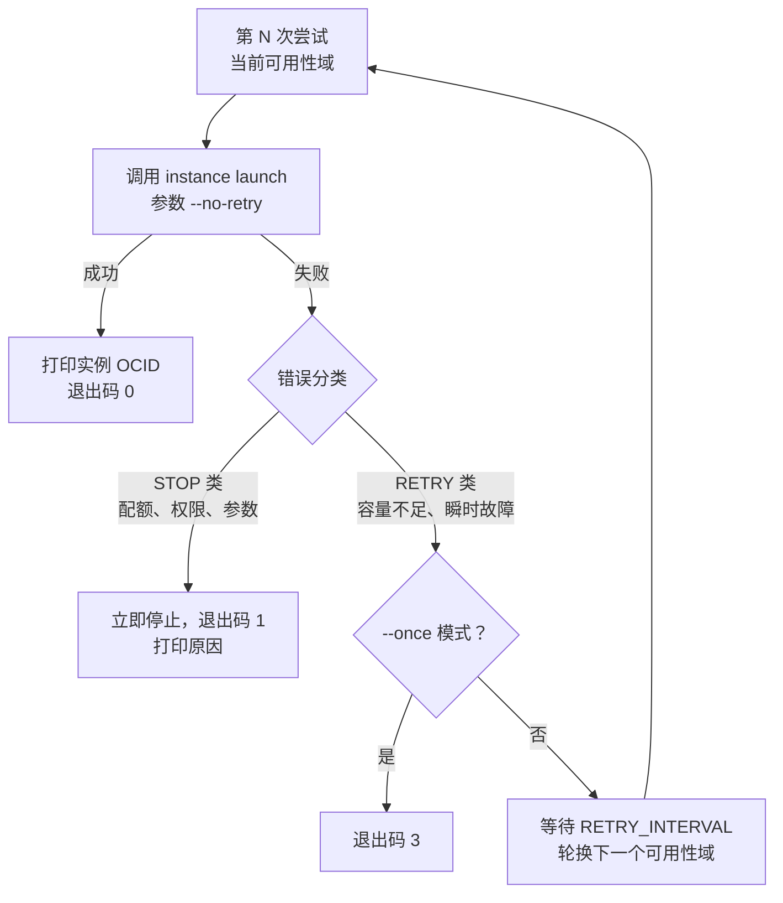

# oci-arm-kit

甲骨文云（OCI）Always Free ARM 实例自动创建工具包。

抢的是 `VM.Standard.A1.Flex`（2 OCPU + 12GB）这一档免费规格。热门区域的 ARM 容量长期紧张，手动点控制台基本抢不到。这个工具包替你盯着：循环调用官方 API 尝试创建，当前可用性域没容量就等一会儿换下一个，抢到之后自动收手，不会重复创建。


## 📖 目录

- [📦 组件](#-组件)
- [🔄 工作流程](#-工作流程)
- [📝 前置条件](#-前置条件)
- [🚀 快速开始](#-快速开始)
- [⚙️ 脚本参考](#-脚本参考)
- [🧠 核心算法](#-核心算法)
- [🩺 离线自检](#-离线自检)
- [❓ 常见问题](#-常见问题)
- [🔒 安全与约定](#-安全与约定)
- [🗂 版本](#-版本)
- [📄 许可](#-许可)

## 📦 组件

| 文件 | 运行位置 | 作用 |
|---|---|---|
| `oci-arm-catcher.sh` | 服务器或任意 Linux | **核心脚本**。循环创建实例，分类错误，轮换可用性域，成功后退出。可独立运行。 |
| `oci-arm-auto.sh` | 服务器（Ubuntu / Debian，可用 E2.Micro 充当） | **部署器**。安装 OCI CLI、生成密钥、引导添加公钥、验证认证、查询子网与镜像、生成配置文件、启动抢购。 |
| `oci-info-from-tabbit.sh` | 本机（Windows + Git Bash） | **提取器**。从已登录的 Tabbit 浏览器读取租户 OCID、用户 OCID、区域代码与指纹。 |
| `tests/catcher-selftest.sh` | 任意（需 python3） | **离线自检**。用桩命令验证核心脚本，不触网。 |
| `GUIDE.md` | — | **使用指南**。含每一项信息的获取位置、格式、验证方法与信息对照检查清单。 |

> 下文固定用三个简称：核心脚本（`oci-arm-catcher.sh`）、部署器（`oci-arm-auto.sh`）、提取器（`oci-info-from-tabbit.sh`）。

## 🔄 工作流程



> 本机这一侧负责把接入信息准备好，服务器那一侧负责挂机执行。

## 📝 前置条件

| 条件 | 说明 |
|---|---|
| Oracle Cloud 账号 | 还没有账号时，先读 [GUIDE.md](GUIDE.md) 第 10 章（注册导读）。**Home Region 选定后不可更改，Always Free 实例只能在 Home Region 创建。** |
| 一台常开的 Linux 服务器 | Ubuntu 或 Debian。可用 Always Free E2.Micro（1/8 OCPU + 1GB）充当引导机，每账号最多 2 台。不要用自己的电脑 24 小时开机。 |
| 网络访问 | 服务器需要能访问 OCI API（`cloud.oracle.com`）。 |

额度口径：实例集上限为全部 A1 实例合计 2 OCPU + 12GB（2026-06 起）。月度用量池以你账号控制台横幅为准。

## 🚀 快速开始

按你的情况挑一条路：

| 你的情况 | 方式 | 入口 |
|---|---|---|
| 用 AI Agent（Claude Code、ZCode 等）代劳 | 方式 C | [Agent 提示词模板](#方式-cagent-提示词调用) |
| 电脑装有 Tabbit，且已登录控制台 | 方式 A | 全自动流水线（GUIDE 4.3） |
| 不用 Tabbit，愿按提示输入少量信息 | 方式 B | 交互式部署（GUIDE 4.2） |
| 想理解原理，逐条命令手工执行 | 方式 D | GUIDE 4.1 全手动 |

**获取工具包**　`git clone https://github.com/Circumsized/oci-arm-kit.git`，或在仓库页 Code → Download ZIP。

### 方式 A：全自动（本机有 Tabbit）

```bash
# 1. 本机读取接入信息。产出 oci-info.env。
bash oci-info-from-tabbit.sh -o oci-info.env

# 2. 上传三个文件到服务器。<KEY> 为 SSH 私钥路径。<SERVER> 为服务器地址。
scp -i <KEY> oci-arm-auto.sh oci-arm-catcher.sh oci-info.env ubuntu@<SERVER>:~/

# 3. 部署。部署器与核心脚本必须位于同一目录。
ssh -t -i <KEY> ubuntu@<SERVER> "source ~/oci-info.env && bash ~/oci-arm-auto.sh"
```

运行到中间会停下来打印一段公钥。把它粘到控制台的 API 密钥页，回来按回车，后面的步骤就全自动了。

### 方式 B：交互式（不需要 Tabbit）

```bash
scp -i <KEY> oci-arm-auto.sh oci-arm-catcher.sh ubuntu@<SERVER>:~/
ssh -t -i <KEY> ubuntu@<SERVER> "bash ~/oci-arm-auto.sh"
```

整个部署过程只有三处需要你动手：粘贴公钥、按一次回车、填入三个标识（用户 OCID、租户 OCID、区域代码）。每一步都标注了在控制台哪里找。装完之后部署器会自动把抢购挂到后台。

部署结束后确认进程存活：

```bash
pgrep -af oci-arm-catcher
```

### 方式 C：Agent 提示词调用

将下面模板补全后发送给 AI Agent。完整模板见 [GUIDE.md](GUIDE.md) 第 5 章。

```text
帮我部署甲骨文 ARM 抢购工具包，信息如下：
- 服务器：ubuntu@<SERVER>，SSH 私钥：<本机私钥路径>
- 工具包文件：本机 oci-arm-auto.sh 与 oci-arm-catcher.sh（同目录）
- OCI_USER_OCID=<用户OCID>   OCI_TENANCY_OCID=<租户OCID>   OCI_REGION=<区域代码>
- API 密钥：请让部署器在服务器生成新密钥，并把公钥给我，我去控制台粘贴
要求：先 scp 上传两个脚本到服务器 → 用 --no-start 部署并回报结果 →
我粘贴公钥后完成后台启动 → 告诉我查看日志的命令。
```

## ⚙️ 脚本参考

### 核心脚本（oci-arm-catcher.sh）

```text
用法: ./oci-arm-catcher.sh [选项]
  --stack-id OCID   启用 Stack 模式，直接执行已创建的 Resource Manager Stack
  --env-file FILE   指定配置文件。默认依次查找 ./arm.env、脚本同目录/arm.env、
                    ./.env、脚本同目录/.env。
  --name NAME       实例显示名。默认 arm-free-1。
  --ocpus N         实例 OCPU 数。默认 2。
  --memory N        实例内存 GB。默认 12。
  --interval SEC    重试间隔秒数。默认 300。低于 300 可能触发限流。
  --once            只尝试一次。成功 0 / 容量不足 3 / 其他错误 1。适合 Agent 巡检。
  -h, --help        显示帮助。   -V, --version  显示版本号。
```

| 配置键（.env 与环境变量同名） | 模式 | 必填 | 说明 |
|---|---|---|---|
| `STACK_OCID` 或 `STACK_ID` | Stack 模式 | 是 | Resource Manager Stack OCID（传入则自动切换为 Stack 模式） |
| `COMPARTMENT_ID` | Direct 模式 | 是 | 租户 OCID（根区间）或子区间 OCID |
| `SSH_KEY_FILE` | Direct 模式 | 是 | 实例登录公钥路径（`.pub` 文件） |
| `SUBNET_ID` | Direct 模式 | 是 | 公有子网 OCID |
| `IMAGE_ID` | Direct 模式 | 是 | aarch64 镜像 OCID |
| `AVAILABILITY_DOMAIN(S)` | Direct 模式 | 是 | 单个，或逗号分隔多个。多个时自动轮换 |
| `DISPLAY_NAME` / `OCPUS` / `MEMORY_GB` / `RETRY_INTERVAL` | 通用 | 否 | 默认 `arm-free-1` / `2` / `12` / `300` |

退出码的含义：`0` 成功，`1` 配置错误或遇到不可重试的错误，`2` 参数错误，`3` 是 `--once` 模式下容量不足。

### 部署器（oci-arm-auto.sh）

```text
用法: bash oci-arm-auto.sh [选项]
  --key FILE            复用已有 API 私钥。指纹自动计算。
  --name NAME           实例显示名。
  --ocpus N             实例 OCPU 数。      --memory N   实例内存 GB。
  --interval SEC        重试间隔秒数。
  --subnet OCID         直接指定子网，跳过查询。   --image OCID  直接指定镜像。
  --os NAME             镜像系统。默认 Canonical Ubuntu。可传 "Oracle Linux"。
  --noninteractive      非交互模式。全部输入来自环境变量。
  --no-start            只部署，不启动抢购。
  -h, --help            显示帮助。   -V, --version  显示版本号。
```

环境变量：`OCI_USER_OCID`、`OCI_TENANCY_OCID`、`OCI_REGION`、`OCI_PUBLIC_KEY_ADDED=yes`、
`OCI_SUBNET_ID`、`OCI_IMAGE_ID`、`OCI_OS`、`OCI_ARM_CATCHER_SRC`。

注意部署器会把核心脚本安装到 `~/oci-arm-catcher/`，并在同目录生成 `.env`，所以两个脚本必须放在同一目录。

### 提取器（oci-info-from-tabbit.sh）

```text
用法: bash oci-info-from-tabbit.sh [-o FILE] [-q]
  -o, --write-env FILE   结果写入 FILE。权限 600。文件含 export，可直接 source。
  -q, --quiet            只输出结果。
  -h, --help / -V, --version
```

## 🧠 核心算法



| 分类 | 匹配的错误 | 行为 |
|---|---|---|
| STOP | `LimitExceeded`、`NotAuthorizedOrNotFound`、`NotAuthenticated`、`InvalidParameter`、`CannotParseRequest`、`NotAllowed`、未知错误 | 立即停止。重试无意义。打印原因，提示检查配额或配置。 |
| RETRY | `Out of host capacity`、`InternalError`、`TooManyRequests`、`ServiceUnavailable`、`timed out`、`RequestException` 等 | 等待 `RETRY_INTERVAL` 秒后重试。多个可用性域时依次轮换。 |

三个设计要点：

1. 启动参数 `--no-retry` 关闭 OCI CLI 的内层重试。每次尝试耗时可控，重试间隔准确。
2. 创建成功后核心脚本自动退出。重跑前先确认是否已创建实例。
3. 2026-06 起，Always Free 的 A1 额度为 2 OCPU + 12GB。超配请求返回 `LimitExceeded`，命中 STOP 分类。

## 🩺 离线自检

自检不联网、不消耗配额，用桩命令喂真实错误流给核心脚本，看它怎么反应：

```bash
bash tests/catcher-selftest.sh

# == 用例 1：容量不足 → 轮换可用性域 → 成功    ✓✓✓
# == 用例 2：LimitExceeded（配额类）→ 立即停止  ✓
# == 用例 3：--once 容量不足 → 退出码 3         ✓
# == 用例 4：缺少必填配置 → 退出码 1            ✓
# == 用例 5：Stack Apply 模式 → 成功            ✓✓
# 全部通过：8 项检查
```

## ❓ 常见问题

**1. 为什么不让工具从浏览器读取 API 私钥？**

读不到，也不该这么做。控制台只在生成密钥的那一刻提供一次私钥下载，之后永不再显示，丢了就只能删掉重建。所以工具包反过来做：私钥在服务器本地生成，全程不经过浏览器，你在控制台粘贴的公钥可以反复粘贴、丢了也无所谓。

**2. 认证失败（`oci iam region list` 报错）怎么办？**

按这个顺序查：公钥是否整段粘贴、添加按钮是否点过、脚本算出的指纹和控制台列表是否一致。部署器允许失败后按回车重试，不用重跑整个流程。

**3. 提取器报"未找到控制台标签页"怎么办？**

先在 Tabbit 里登录 `cloud.oracle.com`，再运行提取器。Oracle 改版后菜单文案可能变化，按报错提示调整提取器里的中文关键词即可。

**4. 日志出现 `LimitExceeded` 后工具停止。这是错误吗？**

不是，这是设计如此。配额已满时再重试也不会有结果，核心脚本直接停下并把原因打印出来，免得白刷接口。

**5. 创建成功后做什么？**

到控制台 Compute → Instances 确认实例，记下公网 IP，然后从跑抢购的那台服务器登录：

```bash
ssh -i ~/.ssh/id_ed25519 ubuntu@<实例公网IP>   # Ubuntu 镜像。Oracle Linux 用 opc。
```

私钥就是服务器上的 `~/.ssh/id_ed25519`。抢购进程在创建成功后已经自己退出了，用 `pgrep -af oci-arm-catcher` 可以确认。

**6. 如何修改配置并重跑？**

改 `~/oci-arm-catcher/.env` 再带参数跑一次核心脚本就行；整机重来时重新运行部署器，它可重复执行，不会覆盖已有密钥。

**7. 有没有其他自动化机制？Resource Manager Stack 是什么？**

有。Resource Manager 的 Stack 相当于把"要创建什么机器"存成一份模板，之后反复执行它。真正触发执行的核心命令很短：

```bash
oci resource-manager job create-apply-job \
  --stack-id "$STACK_OCID" \
  --execution-plan-strategy AUTO_APPROVED
```

核心脚本已经内置了这个模式，不必自己包一层循环。如果你在控制台（Developer Services → Resource Manager → Stacks）存过一个 A1 Flex Stack，直接这样跑：

```bash
./oci-arm-catcher.sh --stack-id "ocid1.ormstack.oc1..."
```

或者把 `STACK_OCID=ocid1.ormstack.oc1...` 写进 `.env`。作业状态的等待、失败后的退避（默认 300 秒）、成功后的退出，脚本都会处理好。

两种模式怎么选：Direct Launch（默认）直接调 Compute API，能在多个可用性域之间轮换重试，命中率最高；Stack Apply 只需要一个 `STACK_OCID`，子网、镜像、SSH 路径全在 Stack 模板里，适合已经把配置放在控制台的人。

**8. 服务器会被甲骨文回收吗？**

会。Oracle 对 Always Free 实例有闲置回收政策，低利用率达到阈值就可能被判定闲置并收回。阈值会变，以官方政策为准。结论很简单：免费实例不适合跑重要业务，有数据就定期备份。

## 🔒 安全与约定

API 私钥只存在服务器的 `~/.oci/oci_api_key.pem`，权限 600，脚本不会把它发往任何地方。仓库源码里没有真实凭据，只有 `ocid1.user.*` 这类格式校验用的模式串，`.gitignore` 也把运行期生成的 `.env` 和密钥文件挡在版本库之外。

脚本只用相对路径和 `$HOME`、`$LOCALAPPDATA` 这类标准环境变量，文档占位符统一为 `<KEY>`、`<SERVER>`、`<实例公网IP>`。

`.env` 和 `oci-info.env` 里装的 OCID 本身不是机密，但整份文件仍建议按凭据对待：权限 600，不要入库。

## 🗂 版本

| 版本 | 日期 | 说明 |
|---|---|---|
| v3.1.0 | 2026-10-13 | 文档补全：GUIDE 新增注册导读章（Home Region、失败排查、E2.Micro 引导机）；新增 401 逐字段检查表、界面版本自检表、进程检查命令、防扣费清单、闲置回收提示；README 新增前置条件与 Stack 替代方案 FAQ；术语表扩充。 |
| v3.0.0 | 2026-10-13 | 核心算法独立成核心脚本。新增离线自检。部署器改为同目录安装，取消 git 依赖。文档重构。 |
| v2.0.0 | 2026-10-13 | 统一帮助、选项与退出码。新增非交互模式、`--no-start`、`--subnet`、`--image`、`--os`。 |
| v1.0.0 | 2026-10-13 | 初版。 |

## 📄 许可

[MIT](LICENSE)